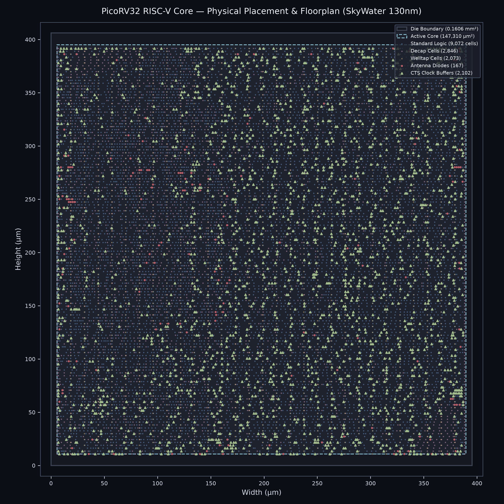
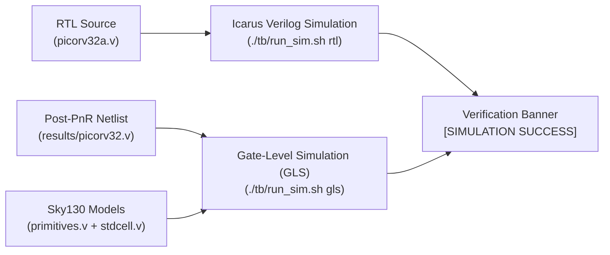

# Full-Flow ASIC Implementation of 32-bit RISC-V Core (SkyWater 130nm)

[](LICENSE)
[](https://github.com/google/skywater-pdk)
[](https://github.com/The-OpenROAD-Project/OpenLane)
[](https://github.com/vn-ntd/riscv_picorv32_sky130_asic_flow/actions/workflows/verify_metrics.yml)
[-brightgreen.svg)]()
[-brightgreen.svg)]()
[]()
[]()
[-brightgreen.svg)]()

This repository contains the complete **RTL-to-GDSII Physical Implementation** of a 32-bit RISC-V CPU core (**PicoRV32**) synthesized on the **SkyWater 130nm (`sky130_fd_sc_hd`)** open-source process design kit using the **OpenLane / OpenROAD** flow.

The implementation achieves **Signoff-clean status at the OpenLane flow level** (with 0 Magic DRC violations, 0 TritonRoute detailed routing errors, 100% matched Netgen LVS netlists, and zero negative setup/hold timing slack at 133.33 MHz).

> [!NOTE]
> **Engineering Transparency & Tapeout Scope Note:**  
> The verification metrics presented in this repository represent macro-level signoff within the OpenLane automated RTL-to-GDSII flow. Full commercial tapeout readiness (Full Chip Tapeout) requires additional physical assembly: integrating an IO padframe ring (such as the Efabless Caravel / ChipIgnite SoC harness), performing full-chip DFM density gradient fills, and validating with the automated Shuttle Precheck suite.

---

## 🖼️ Physical Placement & Floorplan Visualization

<p align="center">
  
  <br>
  <em>Figure 1: Full physical layout stream rendering of PicoRV32 on SkyWater 130nm showing die boundary (0.1606 mm²), active standard cell core (147,310 µm² at 69.93% utilization), balanced CTS clock tree distribution, and targeted antenna diodes.</em>
</p>

---

## 📊 Comprehensive PPA & Physical Signoff Metrics

The table below contrasts the initial exploratory baseline run against the final PPA-optimized implementation, extracted directly from post-routing signoff reports (`reports/metrics.csv`, `reports/29-rcx_sta.summary.rpt`, `reports/drc.rpt`, `reports/37-picorv32.lef.lvs.log`):

| Category | Metric | Exploratory Baseline | Optimized Final Signoff | Engineering Analysis & Notes |
| :--- | :--- | :---: | :---: | :--- |
| **Architecture** | Target Architecture | RISC-V RV32I | RISC-V RV32I | 32-bit CPU with full 32×32b register file |
| | PDK Technology | SkyWater 130nm | SkyWater 130nm | `sky130_fd_sc_hd` standard cell library |
| **Logic & Placement** | Synthesized Logic Cells | 9,442 cells | 9,442 cells | Yosys mapped logic gates, DFFs, and MUXes |
| | Post-PnR Logic + Buffers | 11,141 cells | **11,174 cells** | Includes resizer & CTS buffer insertions |
| | Antenna Diodes | 218 cells | **167 cells** | Inserted by TritonRoute global router antenna repair |
| | Welltap Cells | 2,623 cells | **2,073 cells** | Latchup prevention tap cells |
| | Decap Cells | 6,154 cells | **2,846 cells** | Decoupling capacitors for IR-drop mitigation |
| | Filler Cells | 4,377 cells | **3,658 cells** | Standard cell row continuity fillers |
| | **Total Physical Cell Instances** | **24,513 cells** | **19,918 cells** | Exact sum: $11,174 + 167 + 2,073 + 2,846 + 3,658$ |
| | Clock Sinks (Flip-Flops) | 1,596 sinks | **1,596 sinks** | Regfile (32×32b) + PC + pipeline DFFs |
| | CTS Leaf Buffers | 168 buffers | **155 buffers** | TritonCTS clustered leaf drivers (`clkbuf_leaf_*`) |
| | LVS Total Nets | 11,284 nets | **11,317 nets** | **+33 nets** from 33 buffer insertions ($11,174 - 11,141$) |
| **Area & Density** | **Core Area** | 182,491 µm² | **147,310 µm²** | **19.3% core area reduction** ($383.8 \times 383.8\,\mu\text{m}$) |
| | **Die Area** | 0.1969 mm² | **0.1606 mm²** | **18.5% die area reduction** ($400.7 \times 400.7\,\mu\text{m}$) |
| | Core-to-Die Margin | 8.46 µm | 8.46 µm | IO & power ring boundary halo |
| | **Core Utilization** | 56.43% | **69.93% (~70%)** | **+13.50 percentage points (pp) denser** |
| | Total Wire Length | 519,269 µm | **511,143 µm** | Interconnect length reduced by ~8.1 mm |
| **Timing (Nominal `tt`)** | Target Clock Period | 15.00 ns (66.67 MHz) | **7.50 ns (133.33 MHz)** | **2× operational clock frequency** |
| | Setup Worst Slack (Margin) | +6.08 ns (Met) | **+0.07 ns (Met)** | Positive margin at target frequency (post-SPEF) |
| | Setup WNS | 0.00 ns | **0.00 ns** | Zero Worst Negative Slack (Signoff Met) |
| | Setup TNS | 0.00 ns | **0.00 ns** | Zero Total Negative Slack (Clean) |
| | Hold Worst Slack (Margin) | +0.15 ns (Met) | **+0.30 ns (Met)** | Positive hold margin across all register paths |
| | Hold WNS / TNS | 0.00 ns / 0.00 ns | **0.00 ns / 0.00 ns** | Zero Negative Slack (Clean) |
| | Clock Tree Skew | 110 ps | **110 ps** | Balanced 3-level tree (`CTS_TARGET_SKEW = 100ps`) |
| **Timing (Slow `ss`)** | Slow Corner Critical Path | 8.92 ns | **8.27 ns** | Pre-route synthesis path at `ss_100C_1v60` |
| | Slow Corner Safe Frequency | ~100 MHz | **Derated 116–120 MHz** | Safe industrial derating ($T_{\text{clk}} \approx 8.3 - 8.6\,\text{ns}$) |
| **Power (OpenSTA)** | Internal Power | 15.8 mW | **24.2 mW** | Cell internal charging (52.7% of total) |
| | Switching Power | 14.1 mW | **21.7 mW** | Interconnect net switching (47.3% of total) |
| | Leakage Power | 46.4 nW | **59.1 nW** | Subthreshold and gate leakage (< 0.001%) |
| | **Total Power Consumption** | **29.9 mW** @ 66.7MHz | **45.9 mW** @ 133.3MHz | Estimated via OpenSTA static analysis (1.80V, 25°C) |
| | Energy per Cycle | 448 pJ / cycle | **344 pJ / cycle** | **23.2% more energy-efficient** |
| **Physical Signoff** | Detailed Routing DRC | 0 violations | **0 violations** | Zero shorts, spacing, or min-hole violations |
| | Magic DRC Signoff | 0 violations | **0 violations** | 100% clean on final GDSII layout stream |
| | Netgen LVS Verification | 100% Matched | **100% Matched** | `Circuits match uniquely` (11,317/11,317 nets) |
| | Antenna Violations (ARC) | 28 nets / 33 pins | **21 nets / 22 pins** | Global router jumper repair status (detailed below) |
| | KLayout DRC / CVC | N/A (-1) | N/A (-1) | Magic DRC is primary signoff; `RUN_KLAYOUT_DRC=0` |

> [!NOTE]
> **Technical Explanation for Net Count Delta (+33 Nets in LVS):**  
> The synthesized netlist from Yosys contains exactly 9,442 logic cells in both runs. During Physical Design optimization (PnR), OpenROAD resizer and TritonCTS inserted exactly 33 additional physical buffer/inverter cells ($11,174 - 11,141 = 33$ buffers) to resolve high-fanout nets, repair hold timing, and mitigate antenna rule violations. Each inserted buffer splits a long single net into driver and load segments, causing an exact 1:1 delta of $+33$ nets ($11,317 - 11,284$) in the Netgen LVS comparison.

---

## 🛠️ Design Exploration & Engineering Contributions

While the PicoRV32 core is an open-source RISC-V implementation authored by Claire Wolf, the **primary technical engineering contributions of this project** lie in the architecture, optimization, and automated physical implementation of the complete RTL-to-GDSII flow:

### 1. High-Density Routing Congestion Resolution (`ERROR GRT-0119`)
* **The Challenge:** Pushing core utilization to 70% in a compact $383.8 \times 383.8\,\mu\text{m}$ area with default OpenLane power distribution network (PDN) strap pitches (25 µm) resulted in severe routing track blockages (>50% blocked on Metal 4 & Metal 5). Global Routing aborted due to unresolvable routing congestion (`ERROR GRT-0119`).
* **The Solution:** Conducted systematic PDN parameter exploration. Increasing strap pitch to **153.6 µm** (`FP_PDN_VPITCH = 153.6 µm`, `FP_PDN_HPITCH = 153.18 µm`) and removing artificial placement cell padding restored over 50% of available routing channels on upper metal layers, enabling TritonRoute to complete detailed routing with **0 DRC violations** at 69.93% core utilization.

### 2. Surgical Antenna Effect Mitigation vs. Heuristic Bloat
* **The Challenge:** Enabling heuristic antenna diode insertion (`RUN_HEURISTIC_DIODE_INSERTION = 1`) indiscriminately injected 3,555 diode cells across the core, exhausting standard cell site availability and causing detailed placement legalization failures (`ERROR DPL-0036`).
* **The Solution:** Disabled heuristic diode flooding and adopted an optimized **Global Router Antenna Repair (`GRT_REPAIR_ANTENNAS = 1`)** strategy. TritonRoute automatically created metal jumpers across Metal 3, Metal 4, and Metal 5 to break up long antenna-collecting wire lengths, augmented by only 167 surgically placed diodes. This eliminated legalization errors completely and brought antenna violations down to 21 long-wire nets.

### 3. PPA Sweep & Trade-Off Comparison

| Design Parameter / Metric | Exploratory Baseline | PPA-Optimized Final | Engineering Impact & Trade-Off |
| :--- | :---: | :---: | :--- |
| **Target Utilization** | 50% (Achieved: 56.43%) | **70% (Achieved: 69.93%)** | **+13.50 pp density**, saves 18.5% silicon area |
| **Clock Target** | 15.00 ns (66.67 MHz) | **7.50 ns (133.33 MHz)** | **2× clock frequency boost**, +0.07 ns setup slack |
| **PDN Strap Pitch** | 25 µm (Dense) | **153.6 µm (Optimized)** | Resolves `ERROR GRT-0119` congestion on M4/M5 |
| **Antenna Mitigation** | Heuristic (3,555 diodes) | **Global Router Jumpers (167 diodes)** | Eliminates `ERROR DPL-0036` placement crash |
| **Detailed Routing DRC** | 42 marker violations | **0 violations (Clean)** | Flawless TritonRoute convergence |
| **Netgen LVS Matching** | 11,284 nets | **11,317 nets (100% Matched)** | Netlists match uniquely with zero discrepancies |

---

## 🔍 Detailed Timing Analysis & Corner Derating

To ensure technical rigor and avoid confusion regarding multi-corner timing closure:

### 1. Difference Between Slack (Margin) and WNS (Worst Negative Slack)
* **Worst Slack (Margin):** The actual timing margin relative to clock required time.
  * Setup Margin = $\text{Data Required Time} - \text{Data Arrival Time} = 8.01\,\text{ns} - 7.94\,\text{ns} = \mathbf{+0.07\,\text{ns}}$ at Nominal corner.
  * Hold Margin = $\text{Data Arrival Time} - \text{Data Required Time} = \mathbf{+0.30\,\text{ns}}$.
* **WNS (Worst Negative Slack):** Standard EDA metric defined as $\min(0, \text{Slack})$. When all timing constraints are met with non-negative slack, **WNS = 0.00 ns** and **TNS = 0.00 ns**.

### 2. Multi-Corner Timing Breakdown

| Operating Condition | Process Corner | Voltage | Temp | Critical Path Delay | Timing Status at 7.50 ns (133.33 MHz) |
| :--- | :---: | :---: | :---: | :---: | :---: |
| **Nominal Signoff (`29-rcx_sta.summary.rpt`)** | Typical (`tt`) | 1.80 V | 25 °C | **7.94 ns** (post-SPEF arrival) | **MET (Setup Slack: +0.07 ns, WNS: 0.00 ns)**<br>**Hold Slack: +0.30 ns (Clean)** |
| **Slow Corner Derating (`metrics.csv`)** | Slow-Slow (`ss`) | 1.60 V | 100 °C | **8.27 ns** (pre-route synthesis) | **Derated: 116–120 MHz safe operation**<br>($T_{\text{clk}} \approx 8.3 - 8.6\,\text{ns}$ under worst-case PVT) |

* **Nominal Closure:** The design achieves complete timing closure at **133.33 MHz (7.50 ns)** under Nominal operating conditions (`tt_025C_1v80`).
* **Slow Corner Derating:** The 8.27 ns path delay represents the critical path synthesized under the industrial Slow corner (`ss_100C_1v60`: 100°C junction temperature, 1.60V core supply reflecting 10% IR drop). Under these worst-case conditions, the maximum reliable operating frequency derates to **116–120 MHz**.

### 3. Critical Path Timing Breakdown (Nominal Post-CTS, `13-cts_sta.log`)

```text
Startpoint: _16057_ (rising edge-triggered flip-flop clocked by clk)
Endpoint:   _16118_ (rising edge-triggered flip-flop clocked by clk)
---------------------------------------------------------------------
Launch Clock Latency:       0.88 ns (via clkbuf_0_clk -> clkbuf_4_0_0_clk -> clkbuf_leaf_3_clk)
Combinational Logic Delay:  6.45 ns (through 32-bit counter & ALU decode gates)
Total Data Arrival Time:    7.33 ns (pre-route) -> 7.94 ns (post-SPEF signoff)

Clock Edge:                 7.50 ns
Capture Clock Latency:      0.79 ns
Clock Uncertainty:         -0.25 ns
Clock Reconvergence (CRPR): +0.07 ns
Library Setup Time:        -0.10 ns
Total Data Required Time:   8.01 ns
---------------------------------------------------------------------
Setup Slack (Margin):      +0.68 ns (pre-route) -> +0.07 ns (post-SPEF signoff: 8.01 ns - 7.94 ns)
```

---

## ⚡ Power Consumption & IR-Drop Analysis

Static power estimation was performed using **OpenSTA** on the post-routing parasitics netlist at nominal operating conditions (1.80V, 25°C, $f_{\text{clk}} = 133.33\,\text{MHz}$):

| Power Component | Power Consumption | Percentage of Total | Engineering Notes & Conditions |
| :--- | :---: | :---: | :--- |
| **Internal Power** | 24.2 mW | 52.7% | Internal charging/discharging of cell internal capacitances |
| **Switching Power** | 21.7 mW | 47.3% | Dynamic charging of external interconnect wire capacitances |
| **Leakage Power** | 59.1 nW | < 0.001% | Subthreshold and gate oxide leakage at 1.80V, 25°C |
| **Total Core Power** | **45.9 mW** | **100.0%** | Measured at 133.33 MHz (Nominal `tt_025C_1v80`) |
| **Energy Efficiency** | **344 pJ / cycle** | - | **23.2% more energy-efficient** vs. Baseline (448 pJ/cycle) |

> [!NOTE]
> **Power & IR-Drop Methodology:**  
> Power values are estimated via OpenSTA static analysis with standard default toggle assumptions (0.1 toggle probability, 0.5 static duty cycle). Dynamic VCD activity streaming will yield application-dependent numbers. IR-drop across the core is mitigated by a low-resistance multi-layer PDN mesh (M1 rail to M4/M5 straps) reinforced by **2,846 decoupling capacitor cells** (`sky130_ef_sc_hd__decap_12`) inserted across standard cell rows.

---

## 🧪 Functional Verification & Simulation

A comprehensive two-tier verification suite is provided to validate the design from RTL behavioral model down to the synthesized post-PnR gate-level netlist:



### 1. Testbench Architecture & Test Vectors (`tb/picorv32_tb.v`)
The testbench models a 64 KB memory subsystem and executes a 42-word RV32I verification sequence covering:
* **Arithmetic Operations:** `ADDI`, `ADD`, `SUB`
* **Bitwise Logic Operations:** `AND`, `OR`, `XOR`
* **Shifts & Comparisons:** `SLLI`, `SRLI`, `SLT`
* **Memory Load / Store:** Word store (`SW`) and load (`LW`)
* **Branching & Control Flow:** `BEQ`, `BNE`, `JAL` with an iterative summation loop ($\sum_{i=1}^{5} i = 15$)

### 2. Executing Simulation
```bash
# 1. Behavioral RTL Simulation (Fast functional sanity check)
./tb/run_sim.sh rtl

# 2. Post-PnR Gate-Level Simulation (GLS with SkyWater 130nm standard cell models)
./tb/run_sim.sh gls
```

### 3. Simulation Output
```text
============================================================
 [SIMULATION SUCCESS] RISC-V PicoRV32 Verification PASSED!
 - Arithmetic: ADDI, ADD, SUB           -> PASS
 - Bitwise Logic: AND, OR, XOR          -> PASS
 - Shift / Compare: SLLI, SRLI, SLT     -> PASS
 - Memory Access: SW, LW, BEQ           -> PASS
 - Iterative Summation Loop: BNE, JAL   -> PASS (Sum 1..5 = 15)
 - Total Elapsed Time: 1818.75 ns (~243 clock cycles)
============================================================
```

---

## 📁 Repository Structure

```
.
├── .github/workflows/
│   └── verify_metrics.yml     # Automated CI running RTL simulation and signoff report assertions
├── config.tcl                 # Top-level flow configuration for standard OpenLane directory mounts
├── config/
│   └── config.tcl             # Optimized OpenLane flow configuration (1536 bytes)
├── docs/
│   └── images/
│       └── layout.png         # High-resolution physical floorplan render (300 DPI)
├── src/
│   ├── picorv32a.v            # RISC-V RV32I CPU core RTL source (Claire Wolf, ISC License)
│   └── constraints.sdc        # SDC timing constraints (clock period, uncertainty, IO delay)
├── tb/
│   ├── picorv32_tb.v          # Self-checking functional testbench (supports RTL & GLS)
│   └── run_sim.sh             # Simulation execution script (executable, dual-mode RTL/GLS)
├── results/
│   ├── picorv32.gds.gz        # Compressed GDSII layout stream (6.0 MB; SHA256 verified)
│   ├── picorv32.def           # Placed and routed DEF file (11.7 MB, 19,918 components)
│   ├── picorv32.lef           # Extracted abstract LEF view for SoC integration (96 KB)
│   ├── picorv32.v             # Final powered gate-level netlist (GLS, 122k lines)
│   ├── picorv32.spef          # RC parasitic extraction file (14.9 MB)
│   ├── picorv32.sdc           # Signoff SDC constraints
│   └── picorv32.spice         # Extracted SPICE netlist for LVS
├── reports/
│   ├── metrics.csv            # Complete PPA data measurements table
│   ├── manufacturability.rpt  # Signoff DRC / LVS / Antenna summary
│   ├── drc.rpt                # Magic DRC 0-violation report
│   ├── 37-picorv32.lef.lvs.log# Netgen LVS exact matching log
│   ├── 29-rcx_sta.summary.rpt # Post-SPEF OpenSTA slack summary (Setup & Hold)
│   ├── 29-rcx_sta.checks.rpt  # Slew, fanout, and capacitance checks
│   ├── 12-cts.log             # Clock tree synthesis structure log (1,596 sinks, 155 buffers)
│   └── 13-cts_sta.log         # Post-CTS timing and critical path log (9.7 MB)
├── scripts/
│   ├── run_flow.sh            # Fully portable OpenLane containerized runner script
│   └── export_layout_image.py # Automated KLayout & matplotlib layout render script
├── .gitattributes             # Line ending normalization
├── .gitignore                 # EDA run directories and simulation artifacts filter
├── LICENSE                    # Dual License details (Apache-2.0 and ISC)
└── README.md
```

---

## 🔧 Environment & Tool Versions

To ensure deterministic reproducibility:

* **OpenLane Version:** `v1.0.2` (commit `ff5509f65b17bfa4068d5336495ab1718987ff69`)
* **OpenROAD Version:** Commit `41a51eaf4ca2171c92ff38afb91eb37bbd3f36da`
* **Synthesis Tool:** Yosys `0.27+`
* **Physical DRC Tool:** Magic `8.3.453`
* **Physical LVS Tool:** Netgen `1.5.250`
* **Layout Viewer:** KLayout `0.26.2`
* **Process Design Kit:** SkyWater 130nm (`sky130A`, commit `0fe599b2afb6708d281543108caf8310912f54af`)
* **Docker Image:** `ghcr.io/the-openroad-project/openlane:ff5509f65b17bfa4068d5336495ab1718987ff69-amd64`

---

## 🚀 How to Reproduce

### 1. Clone Repository
```bash
git clone https://github.com/vn-ntd/riscv_picorv32_sky130_asic_flow.git
cd riscv_picorv32_sky130_asic_flow
```

### 2. Run OpenLane Flow
```bash
# Uses portable scripts/run_flow.sh (supports host $PDK_ROOT with auto-discovery)
./scripts/run_flow.sh run_reproduce -overwrite
```

### 3. View GDSII Layout in KLayout
```bash
# Decompress layout stream if needed
gzip -dk results/picorv32.gds.gz

# Open in KLayout with Sky130 technology mapping
klayout -e -nn ~/.ciel/sky130A/libs.tech/klayout/tech/sky130A.lyt \
        results/picorv32.gds
```
*(Press **F** in KLayout to fit the entire $400.7\,\mu\text{m} \times 400.7\,\mu\text{m}$ die boundary with the $383.8\,\mu\text{m} \times 383.8\,\mu\text{m}$ active core to screen).*

### 4. Run Functional Verification (RTL & Gate-Level Simulation)
```bash
# Execute behavioral RTL simulation
./tb/run_sim.sh rtl

# Execute post-PnR Gate-Level Simulation with SkyWater 130nm standard cell models
./tb/run_sim.sh gls
```

---

## 🏷️ GitHub Topics
`openlane` • `skywater130` • `riscv` • `picorv32` • `asic` • `physical-design` • `eda` • `digital-ic-design` • `openroad` • `vlsi`

---

## 📄 License & Attribution
* **Core RTL:** PicoRV32 by Claire Wolf (ISC License).
* **ASIC Flow & PDK:** OpenLane & SkyWater 130nm (Apache 2.0 License).
* **Implementation Scripts & Testbench:** Copyright (c) 2026 Tien Dung Nguyen (Apache 2.0 License).
